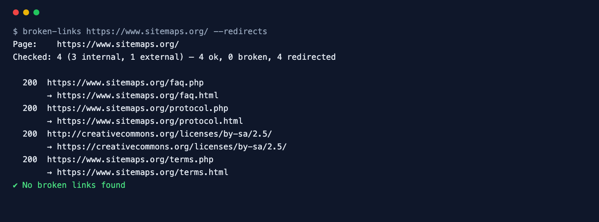

<div align="center">

# Broken Link Checker

**Find dead links, missing images and redirect hops on any page in seconds.**

[](https://github.com/ksanyok/broken-links/actions/workflows/ci.yml) [](LICENSE)   [](https://promopilot.link/en/tools/broken-links.php?utm_source=github&utm_medium=repo&utm_campaign=tools&utm_content=broken-links)

**[▶ Use the free online version — no install, no sign-up](https://promopilot.link/en/tools/broken-links.php?utm_source=github&utm_medium=repo&utm_campaign=tools&utm_content=broken-links)**

</div>

`broken-links` loads a page, collects every link — and with `--assets` every image, script, stylesheet and iframe — and checks them all in parallel. Each URL gets a lightweight `HEAD` request, with a `GET` fallback for servers that reject `HEAD`, a timeout, and redirect following. The report lists what is broken (4xx, 5xx, timeouts, DNS failures, malformed URLs) together with the anchor text, so you can find the link on the page, plus which links go through redirects.



## What it checks

- Every `<a href>` on the page, resolved against the page URL and `<base>`, deduplicated with how often it appears
- With `--assets`: images, scripts, stylesheets, icons, preloads and iframes
- HTTP 4xx and 5xx responses, timeouts, DNS and connection failures, malformed URLs
- Links that redirect, with the final destination (`--redirects`)
- Internal vs. external links and `nofollow` / `sponsored` / `ugc` attributes
- Servers that reject HEAD requests (405, 403, 501) are re-checked with GET to avoid false alarms

## Why it matters

Links rot: pages are deleted, shops discontinue products, partners rebrand their domains. Every broken link is a dead end for a visitor and wasted crawl budget for search engines, and broken outbound links make content look neglected. Missing images and scripts are worse — the page simply looks broken. Because nothing alerts you when an external page disappears, a scheduled check of your key pages is the only reliable way to keep them clean.

## Quick start

```bash
# run straight from GitHub, nothing to install
npx github:ksanyok/broken-links example.com

# or install the CLI globally
npm install -g github:ksanyok/broken-links
broken-links example.com
```

Include images, scripts and stylesheets:

```bash
broken-links https://example.com --assets
```

Only outbound links, slower and gentler:

```bash
broken-links https://example.com/resources --external --concurrency 3 --timeout 30000
```

Export results:

```bash
broken-links https://example.com --json | jq -r '.broken[] | "\(.status) \(.url)"'
```

## Example output

```text
$ broken-links https://www.sitemaps.org/ --redirects
Page:    https://www.sitemaps.org/
Checked: 4 (3 internal, 1 external) — 4 ok, 0 broken, 4 redirected

  200  https://www.sitemaps.org/faq.php
       → https://www.sitemaps.org/faq.html
  200  https://www.sitemaps.org/protocol.php
       → https://www.sitemaps.org/protocol.html
  200  http://creativecommons.org/licenses/by-sa/2.5/
       → https://creativecommons.org/licenses/by-sa/2.5/
  200  https://www.sitemaps.org/terms.php
       → https://www.sitemaps.org/terms.html
✔ No broken links found
```

## CLI

```text
Usage: broken-links <url> [options]

Collects every link on a page (and optionally images, scripts, stylesheets and
iframes), checks them in parallel and reports 4xx/5xx responses, timeouts,
DNS failures, invalid URLs and redirects.

Options:
  --assets            Also check images, scripts, stylesheets and iframes
  --internal          Only links to the same host
  --external          Only links to other hosts
  --redirects         List links that redirect
  --concurrency <n>   Parallel requests (default: 8)
  --timeout <ms>      Timeout per request (default: 15000)
  --json              Print JSON
  -h, --help          Show this help

Online version (no install): https://promopilot.link/en/tools/broken-links.php?utm_source=github&utm_medium=cli&utm_campaign=tools&utm_content=broken-links
```

## Use as a library

```js
import { findBrokenLinks, extractLinks, checkUrl } from '@promopilot/broken-links';

const r = await findBrokenLinks('https://example.com/blog', { assets: true, concurrency: 6 });
console.log(r.summary);
for (const b of r.broken) console.log(b.status ?? b.error, b.url, b.text);

// Building blocks
extractLinks(html, 'https://example.com/page', { assets: true });
await checkUrl('https://example.com/file.pdf', { timeout: 10000 });
```

`findBrokenLinks(url, { assets, scope, concurrency, timeout, userAgent, fetch })` returns `{ url, finalUrl, checked, summary, links[], broken[], redirected[], ok }`. Each link has `url`, `kind` (`link`, `image`, `script`, `resource`, `iframe`), `internal`, `count`, `text`, `nofollow`, `status`, `finalUrl`, `redirected`, `ms` and `error`.

## Use in CI (GitHub Actions)

Check your most important pages every week:

```yaml
on:
  schedule: [{ cron: '0 6 * * 1' }]
jobs:
  links:
    runs-on: ubuntu-latest
    steps:
      - uses: ksanyok/broken-links@v1
        with:
          args: https://example.com --assets
```

## How it works

The page is fetched with Node's built-in `fetch`; comments and inline scripts are removed before links are collected, so commented-out markup does not produce false reports. URLs are resolved with the WHATWG `URL` API, fragments are dropped and duplicates merged. A small worker pool checks them in parallel: `HEAD` first, then `GET` (with the body discarded) when the server answers with a status that often means "HEAD not supported". Every request has an `AbortController` timeout. The tool checks one page; it is not a site crawler.

## CLI vs. online version

| | This package | [Online tool](https://promopilot.link/en/tools/broken-links.php?utm_source=github&utm_medium=repo&utm_campaign=tools&utm_content=broken-links) |
|---|---|---|
| Runs on | Your machine, CI, cron | Any browser |
| Scope | One page, links and assets | One page |
| Tuning | Concurrency, timeout, internal/external | Defaults |
| Output | Text, JSON, exit codes | Visual table |
| Price | Free, MIT | Free, no sign-up |


## FAQ

<details>
<summary><b>Does it crawl the whole site?</b></summary>

No, it checks one page at a time. Run it over a list of key pages (or your sitemap URLs) in a loop or a CI matrix.
</details>

<details>
<summary><b>Why does a link work in my browser but fail here?</b></summary>

Some sites block automated clients (403, 429) or require JavaScript or cookies. Treat those as "check manually"; the anchor text helps you find them.
</details>

<details>
<summary><b>Are redirects a problem?</b></summary>

A redirect is not broken, but every hop slows users down. Update internal links to point to the final URL; use `--redirects` to list them.
</details>

<details>
<summary><b>Will it overload the target site?</b></summary>

By default 8 requests run in parallel, mostly HEAD. Lower `--concurrency` for small sites or external checks.
</details>

<details>
<summary><b>Are links inside JavaScript-rendered content found?</b></summary>

No, only links in the HTML the server returns.
</details>

<details>
<summary><b>Is there a version without installing anything?</b></summary>

Yes — the [online Broken Link Checker](https://promopilot.link/en/tools/broken-links.php?utm_source=github&utm_medium=repo&utm_campaign=tools&utm_content=broken-links) runs the same checks in the browser and explains each result.
</details>

## Related free tools

- [Redirect Checker](https://promopilot.link/en/tools/redirect-checker.php?utm_source=github&utm_medium=repo&utm_campaign=tools&utm_content=redirect-checker) — trace redirect chains, loops and status codes
- [Sitemap Analyzer](https://promopilot.link/en/tools/sitemap-analyzer.php?utm_source=github&utm_medium=repo&utm_campaign=tools&utm_content=sitemap-analyzer) — validate XML sitemaps and sitemap indexes
- [Robots.txt Checker](https://promopilot.link/en/tools/robots-checker.php?utm_source=github&utm_medium=repo&utm_campaign=tools&utm_content=robots-checker) — test robots.txt rules against any URL
- [Website Status](https://promopilot.link/en/tools/website-status.php?utm_source=github&utm_medium=repo&utm_campaign=tools&utm_content=website-status) — is a site down for everyone or just you
- [Meta Tag Analyzer](https://promopilot.link/en/tools/meta-analyzer.php?utm_source=github&utm_medium=repo&utm_campaign=tools&utm_content=meta-analyzer) — title, description, canonical, robots and Open Graph
- [All 120+ free SEO, email and web tools](https://promopilot.link/en/tools/?utm_source=github&utm_medium=repo&utm_campaign=tools&utm_content=broken-links)

## Contributing

Bug reports and pull requests are welcome — see [CONTRIBUTING.md](CONTRIBUTING.md). Security issues: [SECURITY.md](SECURITY.md).
More docs live in the [wiki](https://github.com/ksanyok/broken-links/wiki) (sources in [docs/wiki](docs/wiki)).

## License

[MIT](LICENSE) © 2026 Alexandr Krikun

---

<sub>Built and maintained by the team behind [PromoPilot](https://promopilot.link/?utm_source=github&utm_medium=repo&utm_campaign=tools&utm_content=broken-links) — link building, SEO monitoring and 120+ free tools for site owners. Also on [YouTube](https://www.youtube.com/channel/UCPB8m7BgaexcZh0Vr49ViYA).</sub>
